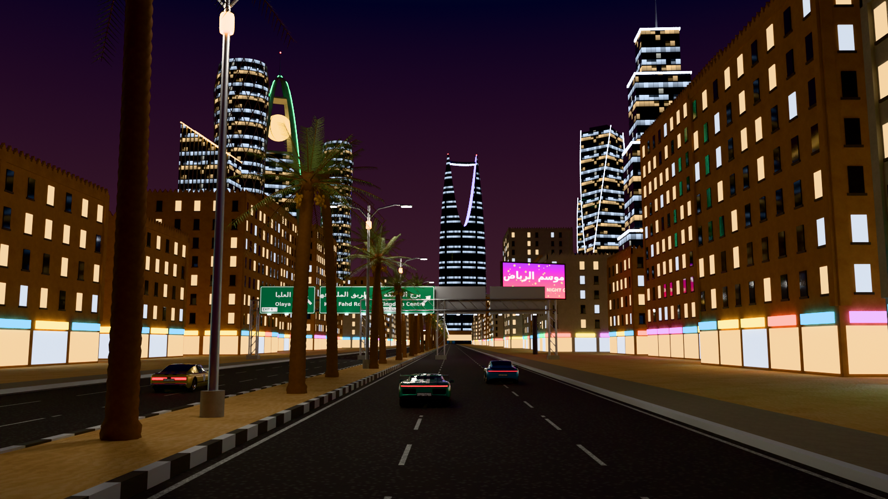
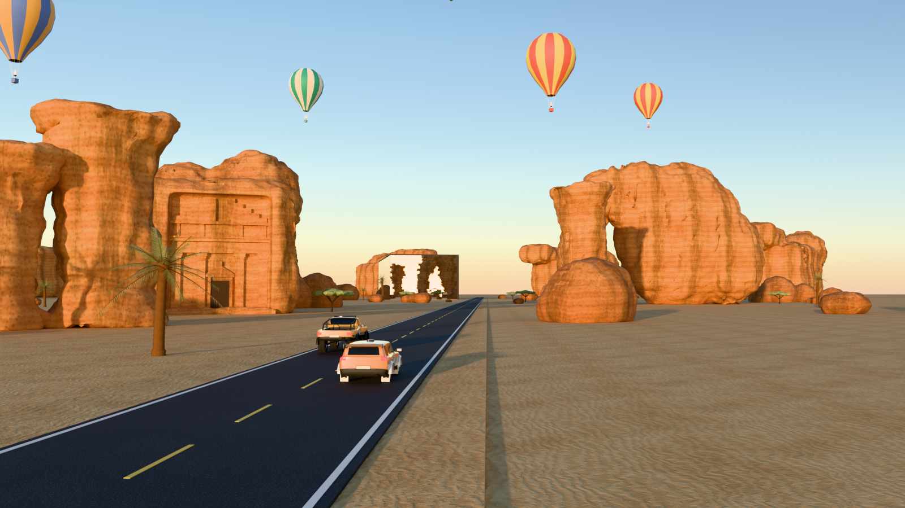
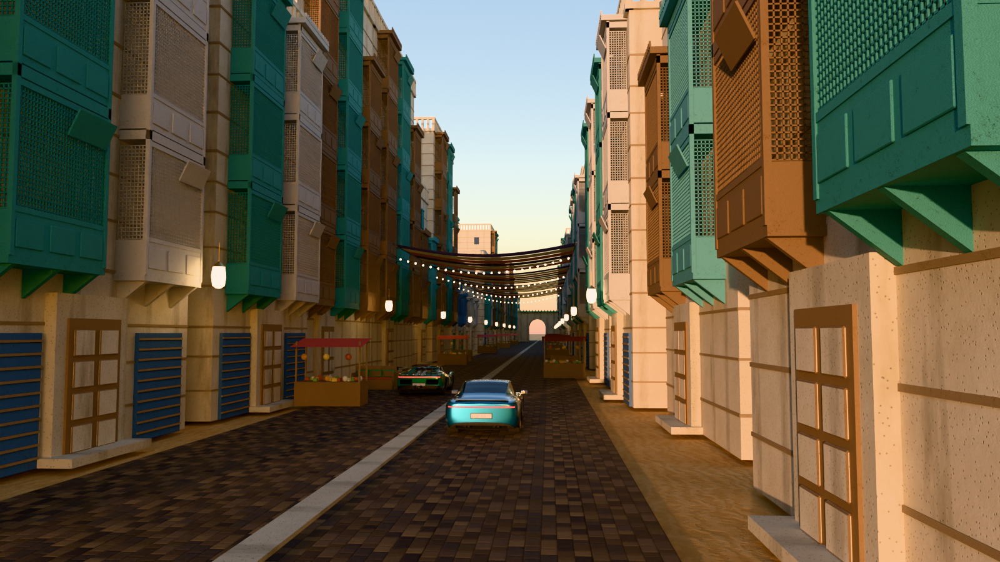
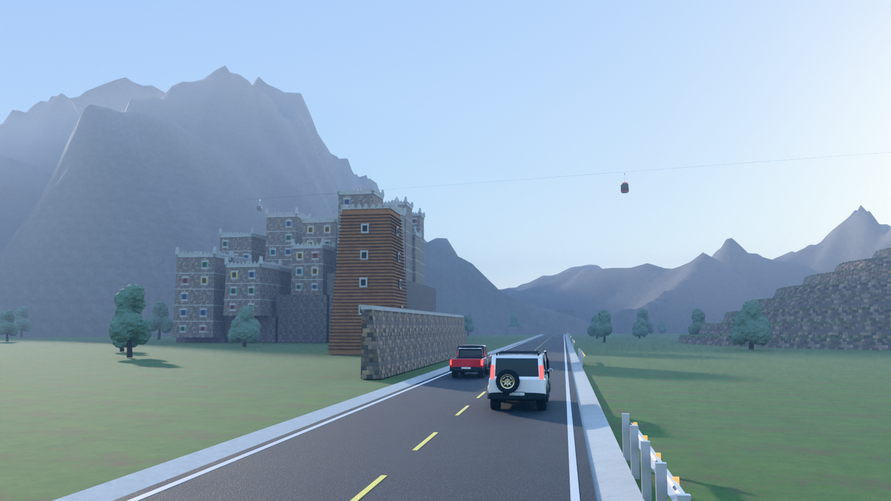
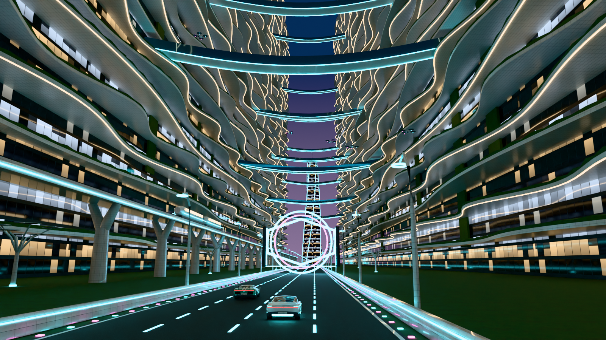
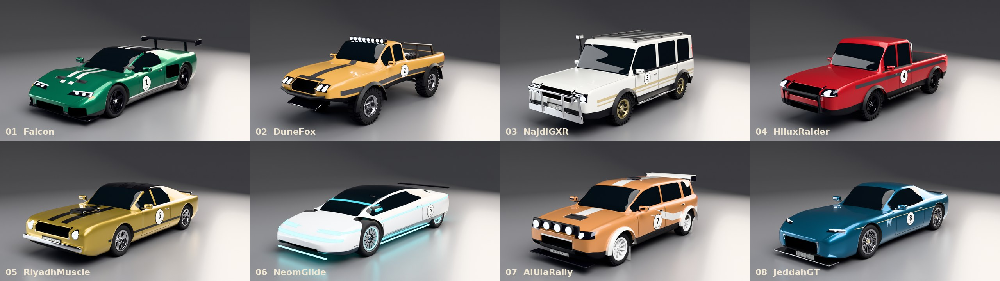
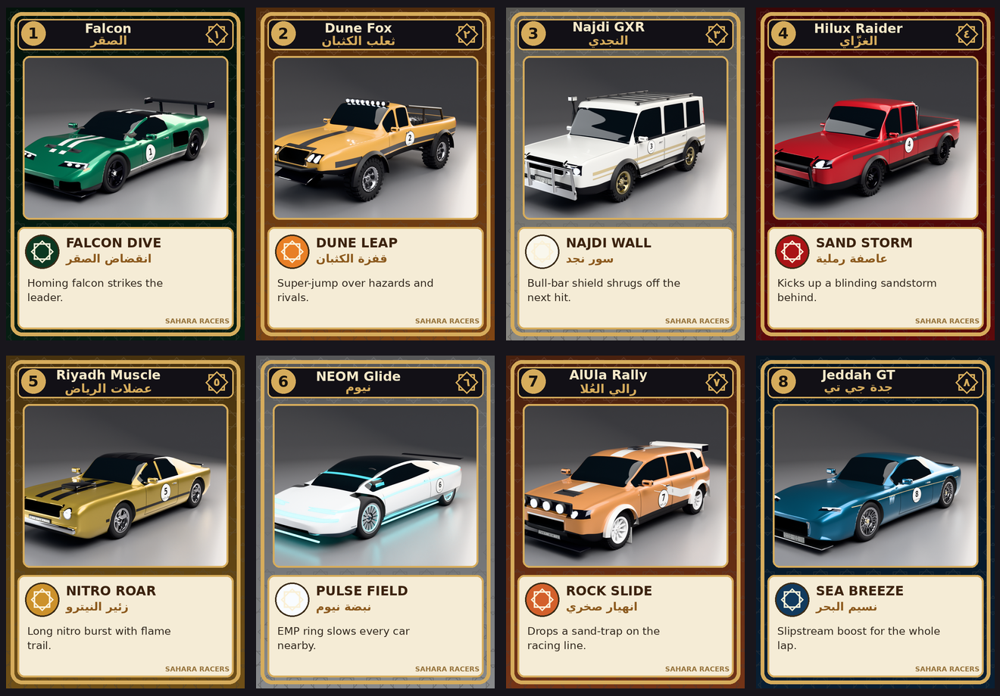

# Sahara Racers — سباق الصحراء

Asset pack and Blender → Unreal Engine 5 pipeline for **Sahara Racers**, an arcade card racing game set
in Saudi Arabia. It has **8 detailed race cars** and **5 map kits** (Riyadh Nights, AlUla, Jeddah
Al-Balad, Asir Mountains, Future City/NEOM). Every landmark is modelled from its real proportions, so
the maps read as the real places.



| AlUla | Jeddah Al-Balad |
|---|---|
|  |  |
| **Asir Mountains** | **Future City (NEOM)** |
|  |  |

*(Blender Cycles renders of the kits; the cars on the roads are the game cars.)*

## The 8 cars



| # | Car | Archetype |
|---|---|---|
| 01 | **Falcon** — الصقر | mid-engine supercar: rear wing, side radiator intakes, LED lights |
| 02 | **Dune Fox** — ثعلب الكثبان | trophy truck: long-travel suspension, roll cage, spare in the bed, light bar |
| 03 | **Najdi GXR** — النجدي | classic boxy desert 4x4: bull bar, snorkel, roof rack, gold steel wheels |
| 04 | **Hilux Raider** — الغزّاي | double-cab pickup: open bed, sports bar with lights |
| 05 | **Riyadh Muscle** — عضلات الرياض | fastback muscle car: hood scoop, chrome bumpers, round lights |
| 06 | **NEOM Glide** — نيوم | electric concept: light-strip signature, covered rear wheels, turbine rims |
| 07 | **AlUla Rally** — رالي العُلا | rally hatch: roof spoiler, light pod, mud flaps, gravel tyres |
| 08 | **Jeddah GT** — جدة جي تي | grand tourer: long bonnet, chrome gills, quad exhausts, mesh wheels |

Each car has:
* a **Chaos Vehicle–ready skeletal mesh** (`Root` + `Wheel_FL/FR/RL/RR`)
* a static body and wheels
* real tyre treads (road, rally, off-road, slick) and 8 rim styles
* recessed intakes and grilles, an interior, door shut-lines and mirrors
* Saudi-format licence plates and a race-number roundel in Arabic and English
* wheel and tuning data in `vehicle_spec.json`

## Cards and abilities



There is one card front per car (`assets/common/textures/T_Card_*`), plus a card back, a 3D card, a
track pickup, and ability meshes: shield, sand tornado, nitro flame, shock ring, sand trap and a homing
falcon.

## What's in the repo

```
assets/
  textures/          tileable PBR textures (sand, AlUla sandstone, coral stone, night facades, ...)
  materials.json     material definitions used by the Unreal import script
  cars/<Car>/        SK_<Car>.fbx (rigged), SM_<Car>_Body.fbx, SM_<Car>_Wheel_F/R.fbx,
                     <Car>_preview.glb (open in Windows 3D Viewer / Blender), vehicle_spec.json
  common/ riyadh/ alula/ jeddah/ asir/ future/
                     SM_*.fbx per asset, kit.json (tris + size), <kit>_kit.blend (editable in Blender)
blender/             the procedural sources (rebuild or tweak anything)
unreal/              import_assets.py (one-click import), setup_map.py (lighting presets per map)
docs/                UNREAL_SETUP.md, MAP_GUIDE.md, previews/
```

| Kit | Highlights |
|---|---|
| **Riyadh** | Kingdom Centre, Al Faisaliah, TV Tower, PIF Tower and KAFD towers, Masmak, Najdi-modern blocks, King Fahd Road, gantry signs, Metro |
| **AlUla** | Qasr al-Farid and a Hegra tomb cliff, Elephant Rock (drive-through), Rainbow Rock, Maraya, hoodoos and mesas, Old Town, balloons |
| **Jeddah** | 6 Hijazi houses with rawasheen, Nassif House with its tree, minaret, Bab Makkah, souq awnings, lanterns, stalls |
| **Asir** | Rijal Almaa houses and village, Asiri mud towers, Al-Qatt Al-Asiri doors, terraces, escarpment mountains, junipers, cable car, mountain-road kit |
| **Future** | The Line (tileable 200 m segment), petal and halo towers, maglev, holo arch, glowing road, drones, solar trees |
| **Common** | palms, acacia, barriers, tyre walls, checkpoint arch, start gantry, boost pad, ramp, cards and pickups, VFX meshes, grandstand |

## Quick start (Unreal Engine 5)

1. Enable **Python Editor Script Plugin**, restart.
2. **Tools → Execute Python Script → `unreal/import_assets.py`**. All textures, materials, meshes
   and cars land in `/Game/SaharaRacers/` with materials assigned.
3. Open your map level and run `unreal/setup_map.py`, then `setup("riyadh")` (or `alula`, `jeddah`,
   `asir`, `future`) for the matching lighting.
4. Swap your car Blueprints to the new skeletal meshes: see **[docs/UNREAL_SETUP.md](docs/UNREAL_SETUP.md)**.
5. Dress each track with its kit: see **[docs/MAP_GUIDE.md](docs/MAP_GUIDE.md)** for layouts and what
   makes each place recognizable.

## Editing in Blender

* Open any `assets/<kit>/<kit>_kit.blend` (Blender 4.2+), or import an FBX or GLB.
* Or change the generator and rebuild:

  ```
  blender -b -P blender/build_all.py -- --no-render       # Blender 5.x
  python blender/build_all.py                             # or with `pip install bpy==5.2.2 pillow arabic-reshaper python-bidi`
  python blender/cars.py Falcon                           # rebuild a single car
  ```

  Car shapes are plain data in `blender/cars.py` (`CARS = [...]`: side/plan profiles, windows,
  lights, cuts, extras). Landmarks are functions in `blender/kit_*.py`.

## Notes

* Built from scratch without access to the original Unreal project, so names and scales follow the
  UE5 Vehicle template conventions (cm, +X forward). Check the first car in your project before
  converting all eight.
* Landmark proportions follow the real buildings. Interiors of landmarks are not modelled.
* Emissive strengths are tuned for the Cycles previews. With Unreal's auto-exposure, adjust
  `EmissiveStrength` on the `MI_` instances to taste.
