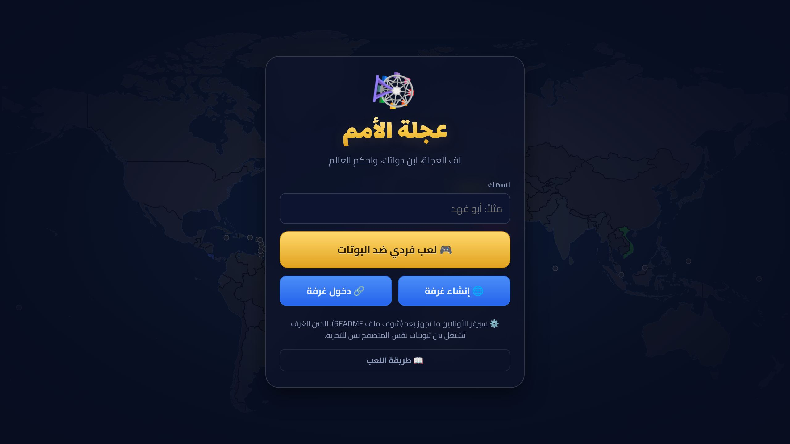
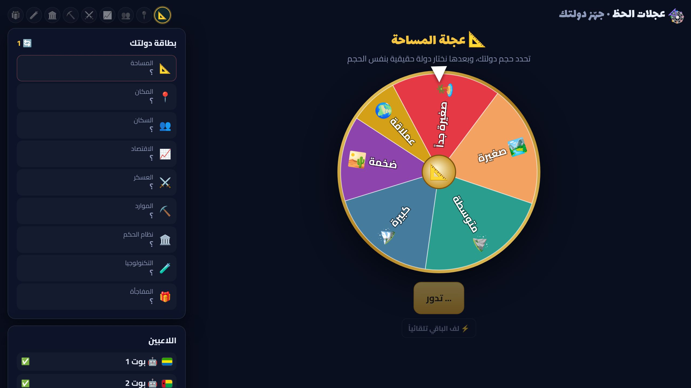
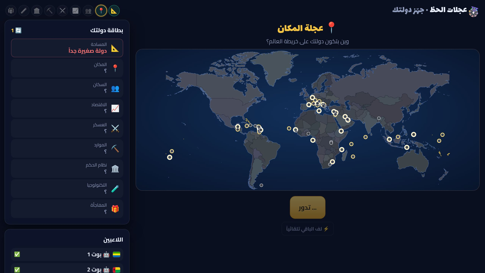
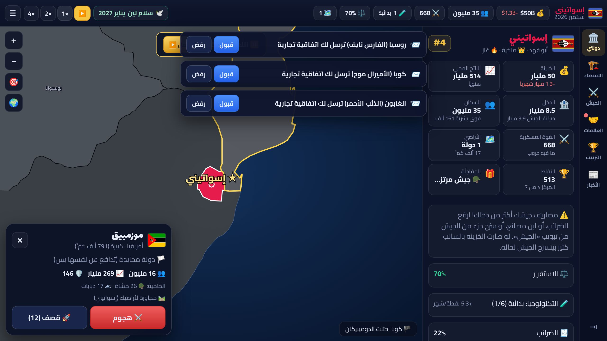
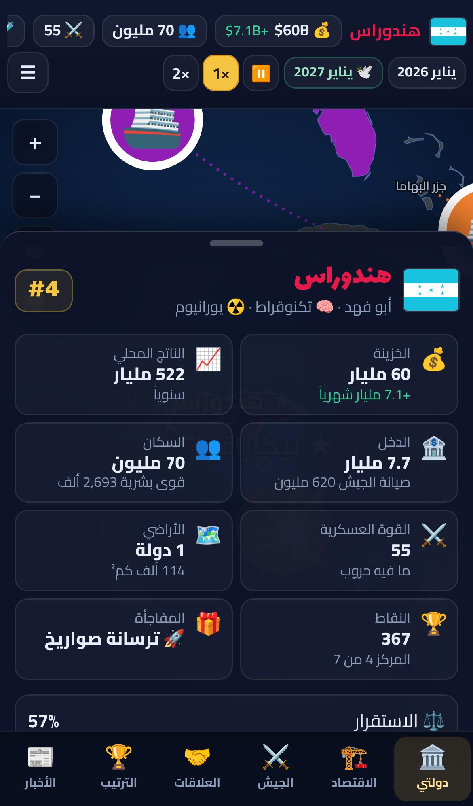

# 🎡 عجلة الأمم

### ▶️ العب الحين: **[wheel-of-nations.netlify.app](https://wheel-of-nations.netlify.app)**

لعبة استراتيجية على **خريطة العالم الحقيقية**. كل لاعب يلف عجلات الحظ عشان يبني دولته (المساحة، والمكان، والسكان، والاقتصاد، والعسكر، وغيرها)، وبعدها تبدأ اللعبة **بالوقت الحقيقي**: تطور اقتصادك، وتشتري أسلحة، وتحتل دول، وتتحالف أو تحارب.

- 🌐 **أونلاين** بغرف بكود ورابط، وعدد اللاعبين مفتوح
- 🎮 **لعب فردي** ضد البوتات (يتحفظ تلقائياً وتقدر تكمل بعدين)
- 🤖 بوتات بشخصيات مختلفة (عدواني، اقتصادي، متوازن، دفاعي) وثلاث مستويات صعوبة
- 📱 تشتغل على الجوال والكمبيوتر، وكلها بالعربي

| القائمة | عجلات الحظ | عجلة المكان |
|---|---|---|
|  |  |  |

| اللعبة | الجوال |
|---|---|
|  |  |

---

## 🎡 عجلات الحظ (12 عجلة قبل اللعبة)

| العجلة | وش تحدد |
|---|---|
| 📐 المساحة | حجم دولتك: صغيرة جداً، صغيرة، متوسطة، كبيرة، ضخمة، عملاقة |
| 📍 المكان | دولة حقيقية **بنفس الحجم** تختارها العجلة على الخريطة |
| 👥 السكان | من 3 مليون إلى 300 مليون (يحدد التجنيد والنمو) |
| 📈 الاقتصاد | الناتج المحلي من 40 مليار إلى 3.5 تريليون |
| ⚔️ العسكر | الجيش اللي تبدأ فيه (من ضعيف جداً إلى قوة عظمى) |
| ⛏️ الموارد | 11 نوع: نفط، غاز، ذهب، يورانيوم، أراضٍ زراعية، معادن نادرة، موانئ، مياه، ثروة سمكية، أخشاب… |
| 🏛️ نظام الحكم | 9 أنظمة، منها «الحكومة الانتقالية» اللي تنلف عجلتها من جديد بعد 4 سنوات |
| 🧪 التكنولوجيا | من مستوى 1 إلى 5 |
| 🧭 القائد | ميزة خاصة: المحارب، الاقتصادي، الدبلوماسي، البنّاء، العالِم، الحامي، الشعبوي، المقامر |
| 🏔️ التضاريس | جبال، صحراء، غابات، سهول، سواحل، جليد، أنهار (تأثر على صعوبة غزو وطنك) |
| 🎯 المهمة السرية | هدف سري محد يعرفه غيرك، ولو حققته تاخذ نقاط ومكافآت |
| 🎁 المفاجأة | 17 مفاجأة: كنز، رأس نووي، كأس العالم، قمر صناعي… أو وباء، حرب أهلية، جنرال خائن، بركان |

- كل لاعب عنده **إعادة لف وحدة** لأي عجلة، والشرائح الضيقة نادرة.
- بعد آخر عجلة تشوف **بطاقة دولتك** كاملة وتضغط **جاهز**، واللعبة تبدأ لما يجهز الكل.

## ⚔️ اللعب

- **الوقت الحقيقي:** الشهر تقريباً 10 ثواني بالسرعة العادية (السنة دقيقتين تقريباً). صاحب الغرفة يقدر يوقفها أو يسرّعها (×2 و ×4).
- **الاقتصاد:** دخل شهري من الضرائب، ومباني (مصانع، بنية تحتية، أبحاث، صحة، تحصينات، دفاع جوي، مصانع حربية، استخراج موارد). الضرائب العالية تنزّل الاستقرار.
- **الجيش:** مشاة، ودبابات، وطائرات، وسفن، وصواريخ باليستية، وقنابل نووية.
- **المعارك:** تستمر **عدة أيام** والخسائر تدريجية. المهاجم ينسحب لو خسر أكثر من نص قوته، والمدافع ينهار لو خسر 70%. يأثر فيها: التكنولوجيا، التحصينات، التضاريس، التفوق الجوي، خلط الأسلحة، بُعد خطوط الإمداد، والإنزال البحري. الحظ اليومي بسيط (±8%) عشان الأقوى يفوز غالباً، وقبل الهجوم تشوف فرصة الفوز والخسائر المتوقعة.
- **الدول المحايدة:** أي دولة ما أخذها أحد تدافع عن نفسها بس، وتقدر تحتلها.
- **الدبلوماسية:** تحالفات، واتفاقيات تجارية، ومساعدات (فلوس أو أسلحة)، وسلام وهدنة، وشات عام وخاص.
- **الفوز (صاحب الغرفة يختار):** أعلى نقاط بعد مدة، أو أول من يسيطر على نسبة من مساحة العالم، أو آخر دولة تبقى.

## 🎲 عنصر المفاجأة (محد يسيطر للأبد)

- **🎰 عجلة الحظ:** كل سنتين تلفها (المقامر كل سنة). كل ما كان ترتيبك متأخر، كبرت شرائح النتايج الحلوة.
- **🌍 عجلة الأحداث العالمية:** كل 3 إلى 4 سنوات تقريباً تلف للكل: أزمة مالية، جائحة، ربيع ثورات، مؤتمر سلام، نيزك، خطة إنقاذ للدول الضعيفة، سباق تسلح… وأغلبها يضرب الدول المسيطرة أقوى.
- **🤝 التحالف الدولي:** لو دولة سبقت الثانية بفرق كبير، البوتات تتحالف ضدها وتعلن الحرب عليها، وهجوم أي أحد عليها يصير أقوى 20%.
- **✊ الإمبراطوريات الكبيرة صعبة:** الأراضي المحتلة حديثاً ممكن تثور لو الاستقرار ضعيف.
- **🛡️ دعم المستضعفين:** الدول المتأخرة بالترتيب جيشها أرخص، ونموها أسرع، ودفاعها أقوى.
- **🎯 المهمات السرية** ممكن تقلب الترتيب بآخر اللعبة.

---

## 💻 تشغيل اللعبة على جهازك

تحتاج [Node.js](https://nodejs.org) نسخة 20 أو أحدث.

```bash
npm install
npm run dev
```

افتح الرابط اللي يطلع لك (عادة `http://localhost:5173`).

للبناء النهائي:

```bash
npm run build
```

الملفات الجاهزة للنشر تطلع في مجلد `dist`.

> 🧪 **بدون سيرفر:** اللعب الفردي يشتغل كامل. والغرف الأونلاين تشتغل بين **تبويبات نفس المتصفح** بس (وضع تجربة). عشان تلعب مع أصحابك من أجهزتهم لازم تجهز Supabase (الخطوة الجاية).

## 🌐 تجهيز اللعب الأونلاين (Supabase، مجاني)

> ✅ **جاهز:** النسخة المنشورة مربوطة بمشروع Supabase اسمه `wheel-of-nations`، والإعدادات موجودة في `public/config.js`. الخطوات تحت لو حبيت تستخدم مشروع ثاني.

اللعبة تستخدم **Supabase Realtime** عشان توصل اللاعبين ببعض. ما تحتاج جداول ولا قاعدة بيانات.

1. ادخل [supabase.com](https://supabase.com) وسو **New project** (الخطة المجانية تكفي).
2. من **Project Settings ← API** انسخ:
   - **Project URL** (مثل `https://abcd1234.supabase.co`)
   - **anon public key**
3. افتح ملف `public/config.js` وحطهم:

   ```js
   window.GAME_CONFIG = {
     supabaseUrl: 'https://abcd1234.supabase.co',
     supabaseKey: 'المفتاح هنا',
   };
   ```

   (بعد البناء يكون الملف في `dist/config.js`، وتقدر تعدله هناك بدون ما تعيد البناء.)
4. تأكد إن **Realtime ← Settings ← Allow public access** شغال (هو شغال تلقائياً في المشاريع الجديدة).

> المفتاح `anon` مصمم إنه يكون في المتصفح، فعادي يكون في الملف.
>
> ⚠️ مشاريع Supabase المجانية **تتوقف بعد أسبوع بدون استخدام**. لو وقف، ادخل لوحة Supabase واضغط **Restore project**.

### كيف تشتغل الغرف؟

- اللي يسوي الغرفة يصير **صاحب الغرفة**، وجهازه يشغّل اللعبة ويرسل حالتها للباقين.
- لو صاحب الغرفة طلع، **أقدم لاعب متصل** يصير صاحب الغرفة واللعبة تكمل.
- لو أحد فصل، **البوت يلعب عنه** لين يرجع. ولو حدّث الصفحة يرجع لدولته تلقائياً.
- تقدر تدخل غرفة حتى بعد ما تبدأ اللعبة: تلف عجلاتك وتاخذ دولة من الدول المحايدة.

## 🚀 النشر

اختر وحدة من هذي الطرق:

**Netlify (الحالي):** اللعبة منشورة على موقع `wheel-of-nations` في حسابك على Netlify، وإعدادات البناء في `netlify.toml`. عشان تنشر تحديث بنفسك: شغّل `npm run build` واسحب مجلد `dist` إلى صفحة **Deploys** في الموقع، أو اربط الموقع بالمستودع من **Site configuration ← Build & deploy**.

**GitHub Pages:**

1. في المستودع: **Settings ← Pages ← Source** واختر **GitHub Actions**.
2. (اختياري) بدل تعديل `config.js`، حط إعدادات Supabase في **Settings ← Secrets and variables ← Actions ← Variables** بالأسماء `SUPABASE_URL` و `SUPABASE_ANON_KEY`.
3. من تبويب **Actions** اختر «نشر على GitHub Pages» واضغط **Run workflow**.

الرابط يكون مثل `https://اسم-الحساب.github.io/game/`.

---

## 🗂️ هيكل المشروع

```
src/
  game/        محرك اللعبة (بدون واجهة)
    engine.ts    الوقت، الاقتصاد، المعارك، الدبلوماسية، العجلات، الفوز
    ai.ts        ذكاء البوتات
    defs.ts      الأرقام والتوازن: الوحدات، المباني، العجلات، الأنظمة، الموارد
    world.ts     بيانات الخريطة والمسافات
  client/      ربط الواجهة بالمحرك (اللعب الفردي وصاحب الغرفة)
  net/         الأونلاين: Supabase Realtime + وضع التجربة المحلي
  ui/          الواجهة (Preact): الخريطة (D3)، العجلات، اللوحات، النوافذ
public/
  data/world.json   خريطة العالم (201 دولة بأسمائها العربية)
  flags/            أعلام الدول
  config.js         إعدادات السيرفر
scripts/
  build-world.mjs   يبني بيانات الخريطة من Natural Earth (npm run build:world)
  sim.ts            محاكاة بوتات بدون واجهة لاختبار التوازن (npm run sim)
```

تبي تعدّل التوازن (أسعار الأسلحة، قوة العجلات، نسب الحظ)؟ كل الأرقام في `src/game/defs.ts`، وجرّب التغيير بسرعة بـ `npm run sim`.

## 📜 المصادر

- الخريطة: [Natural Earth](https://www.naturalearthdata.com) عن طريق [world-atlas](https://github.com/topojson/world-atlas) (ملكية عامة)
- الأعلام: [flag-icons](https://github.com/lipis/flag-icons) (رخصة MIT)
